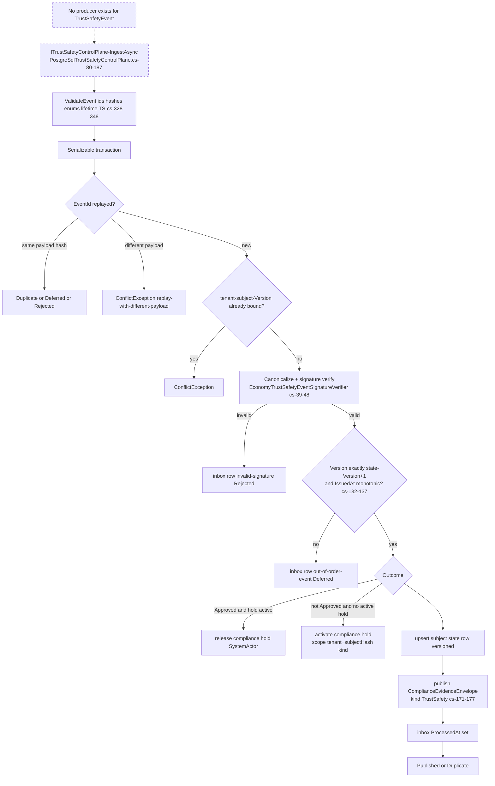
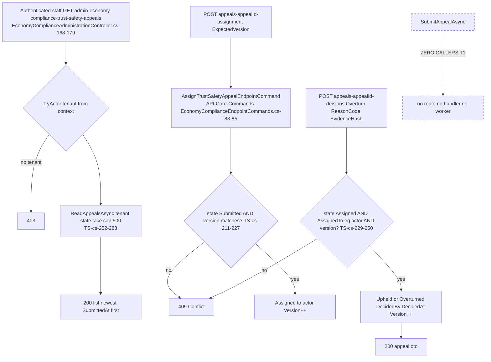
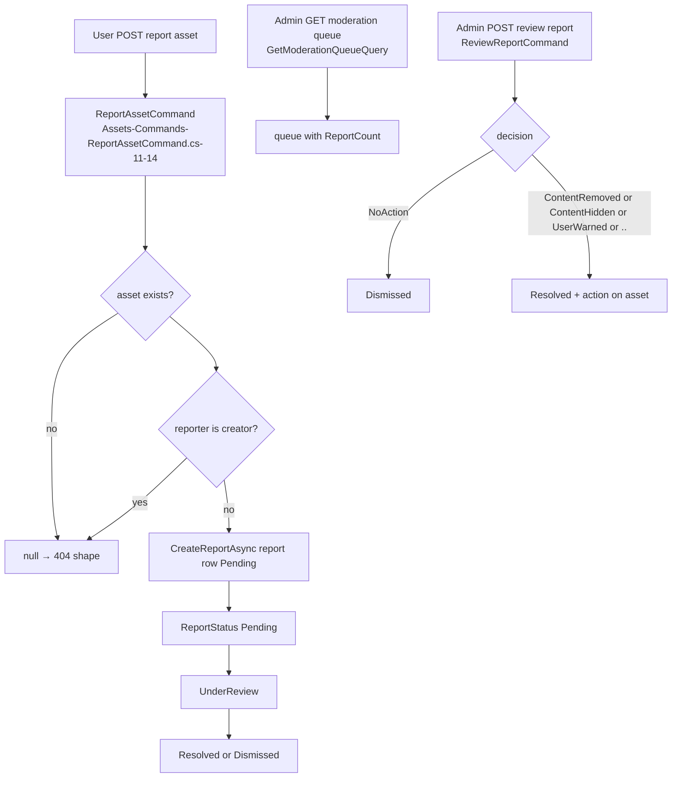
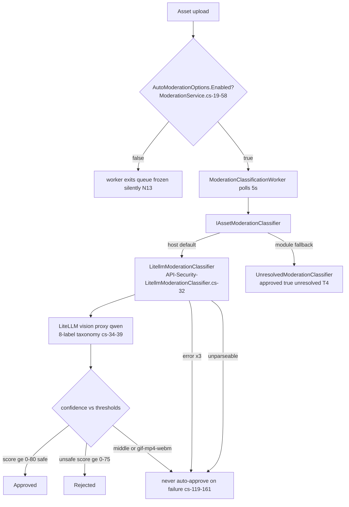
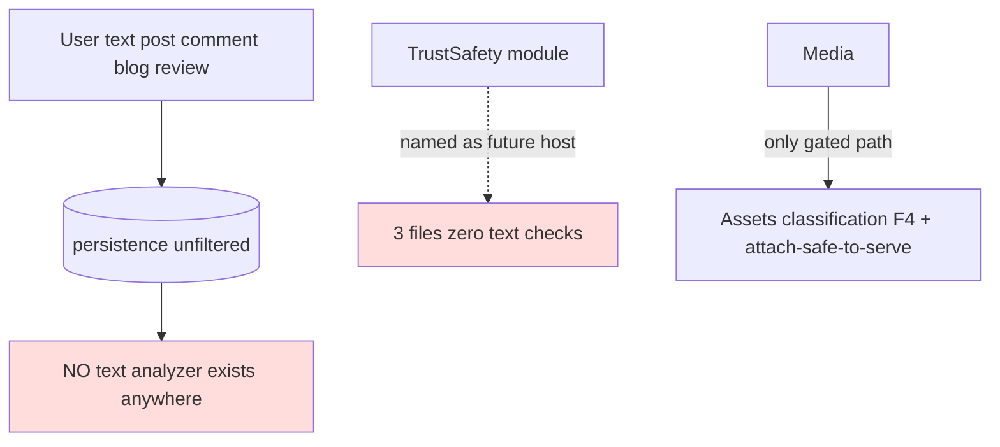

# TrustSafety — User flows

> Module `GameGuild.TrustSafety` + adjacent content-safety surfaces · develop `ce31d5850c`. Family numbering F1-F5 matches 07/08.

## F1 — Trust/safety evidence ingestion (DESIGNED — no producer exists, T1)

Edge cases:

| Case | Behavior | Evidence |
|---|---|---|
| Replay same id + same payload + processed | `Duplicate` | `TS:/PostgreSqlTrustSafetyControlPlane.cs:88-104` |
| Replay same id + same payload + previously deferred | `Deferred` (retryable) | `:100-102` |
| Replay same id, different payload | hard conflict | `:92-95` |
| Version gap | deferred (`out-of-order-event`), not rejected — ordering tolerance | `:132-137` |
| Non-Approved outcome on subject with expired hold | new hold activated | `:145-155` |
| DB check constraints back the guards | version>0, lifetime, policyVersion>0 | `TS:/TrustSafetyPersistence.cs:22-24, 43-45` |

## F2 — Appeal review console (live surface, empty table by construction)

Edge cases:

| Case | Behavior | Evidence |
|---|---|---|
| Concurrent assignment | expectedVersion optimistic check → 409 | `TS:/PostgreSqlTrustSafetyControlPlane.cs:217-220, 237-239` |
| Decide by non-assignee | refused (`AssignedTo != actorId`) | `:237` |
| Decision evidence | `reasonCode` + `evidenceHash` mandatory, 422-shaped validation | `:234-235` |
| DB-enforced decision consistency | check constraint couples State∈{1,2}↔null decider / State∈{3,4}↔decider+timestamp | `TrustSafetyPersistence.cs:70-72` |

## F3 — Asset report → review → action (the real report lifecycle, in Assets)

Edge cases:

| Case | Behavior | Evidence |
|---|---|---|
| Self-report blocked | creator cannot report own asset | `Assets:/Commands/ReportAssetCommand.cs:51-58` |
| Report reasons enum | Inappropriate Copyright Spam Violence … | `Assets:/Models/Enums.cs:111-136` |
| Review decisions enum | NoAction ContentRemoved ContentHidden UserWarned … | `Enums.cs:156-168` |
| Report statuses | Pending UnderReview Resolved Dismissed | `Enums.cs:138-150` |
| Validators present (unlike Gamification) | FluentValidation on both commands | `ReportAssetCommand.cs:21-28`; `ReviewReportCommand.cs:19-26` |

## F4 — Auto-moderation classification lane (images only)

Edge cases:

| Case | Behavior | Evidence |
|---|---|---|
| API key missing | throws `ModerationClassificationException` → NeedsReview path | `LitellmModerationClassifier.cs:57-61` |
| Model output garbage | parse failure throws → callers route to NeedsReview, never approval | `:119-161` doc |
| Human-review MIME types | gif/mp4/webm always human | `Assets:/Moderation/ModerationService.cs:50-58` |
| Disabled = silent freeze | worker exits; uploads pile Pending; nothing alerts | `docs/social-platform/05-gaps.md:53-54` (N13) |

## F5 — Zero text moderation (the #1250 N1 truth)

The flowchart documents an absence: every text surface (`Social.Posts` 26 endpoints, comments, blog, ratings review text) persists unfiltered (`docs/social-platform/05-gaps.md:17-18`); TrustSafety contains no text APIs; the only policy vocabulary that exists is the image label taxonomy (F4). Product decision pending (#1250 note 3).
