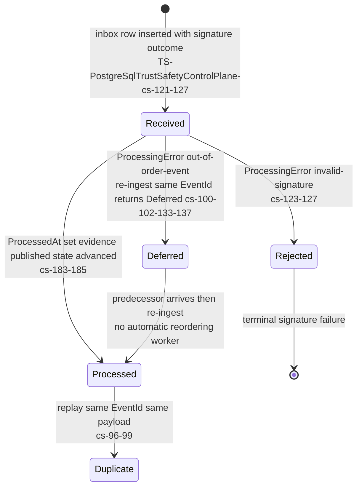
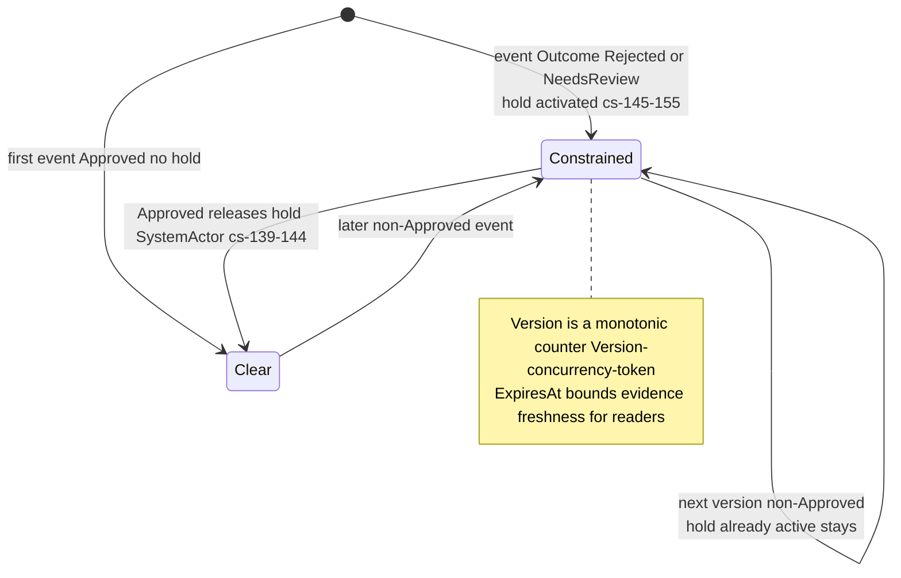
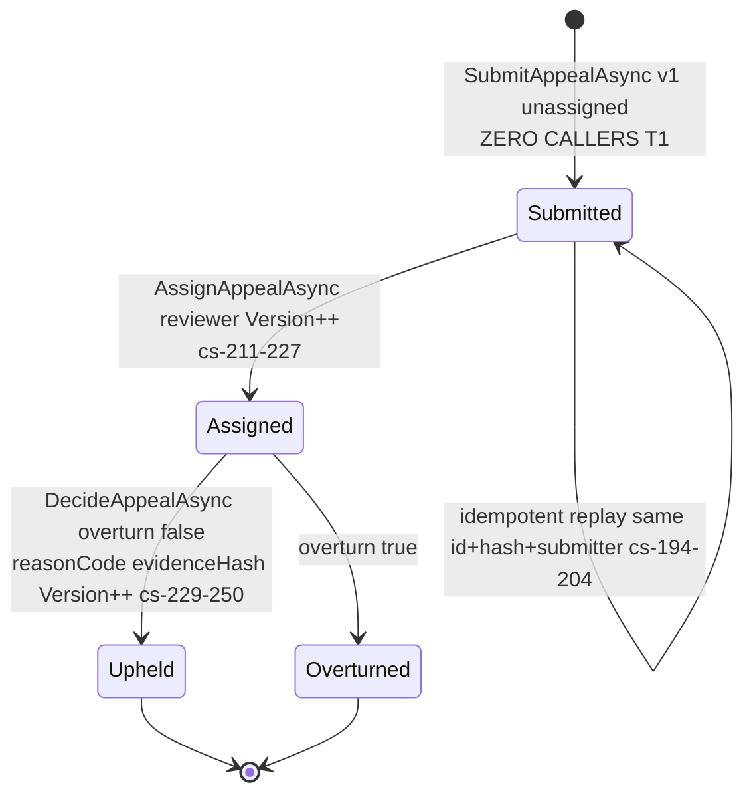
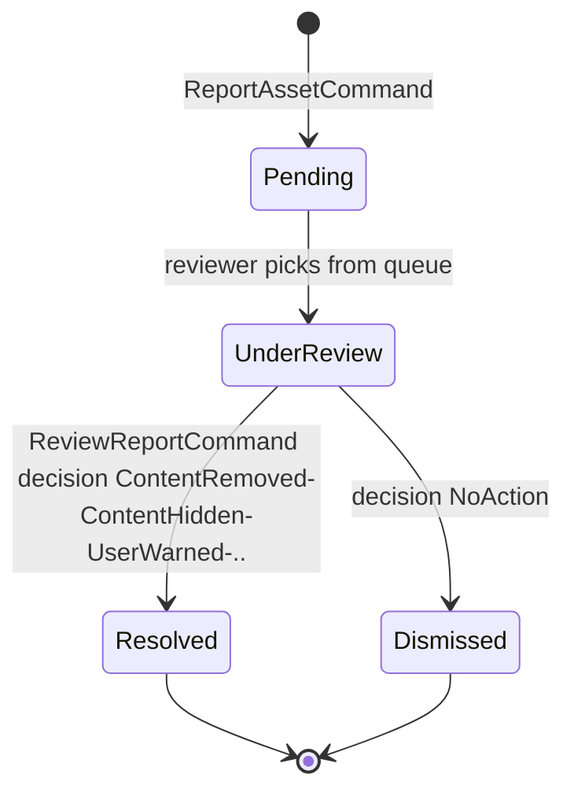
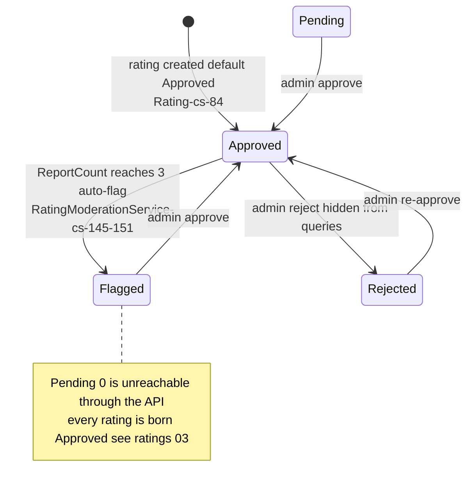

# TrustSafety — State machines

> Module `GameGuild.TrustSafety` + adjacent report lifecycles · develop `ce31d5850c`. Shorthand `TS:`, `Assets:`, `Ratings:`.

## 1. Evidence event inbox row (`trust_safety_event_inbox`)

Not a classic state machine — a processing-outcome column (`ProcessedAt`, `ProcessingError`) with three terminal shapes:

| Guard | Enforcement |
|---|---|
| exactly-once per EventId | unique index (`TrustSafetyPersistence.cs:33`) |
| one event per (tenant, subject, version) | unique composite index (`:34-35`) |
| replay with different payload | `TrustSafetyConflictException` (`PostgreSqlTrustSafetyControlPlane.cs:92-95`) |
| no automatic retry of Deferred | only re-ingestion of the same event re-evaluates (design: caller retries) |

## 2. Subject state (`trust_safety_subject_states`, keyed tenant+subjectHash)

The economy **reads** this via `PostgreSqlTrustSafetyRiskInputSource` (evidence `ExpiresAt` honored — `TS:/TrustSafetyModule.cs:40-58`); expired evidence reads as `Unavailable` → economy treats as no-objection-by-default? No — `ExternalRiskOutcome.Unavailable` propagates and the **economy policy** decides what Unavailable means (see docs/economy risk chain).

## 3. Appeal (`trust_safety_appeals`)

| Guard | Enforcement |
|---|---|
| new appeal must be `Submitted`, v1, unassigned, undecided | `ValidateAppeal` (`:350-367`) |
| only Submitted can be assigned, version-checked | `:217-220` |
| only Assigned-to-this-reviewer can decide, version-checked | `:237-239` |
| decision fields coupled to state | DB check constraint (`TrustSafetyPersistence.cs:70-72`) |
| optimistic concurrency | `Version` concurrency token on the row (`:80`) |

Note the deliberate hard stop: **no Un-assign, no reopen, no re-appeal transition** — the lifecycle is one-shot by design.

## 4. Content report lifecycles (the surfaces users actually touch)

**Assets report** (`ReportStatus`, `Assets:/Models/Enums.cs:138-150`):

**Ratings report → moderation** (`Ratings:/Entities/Rating.cs` + `Services/RatingModerationService.cs`):

**Asset moderation status** (`ModerationStatus`, `Assets:/Models/Enums.cs:84-96`): Pending → Processing → Approved / Rejected / NeedsReview, driven by the classification lane (01 F4).
