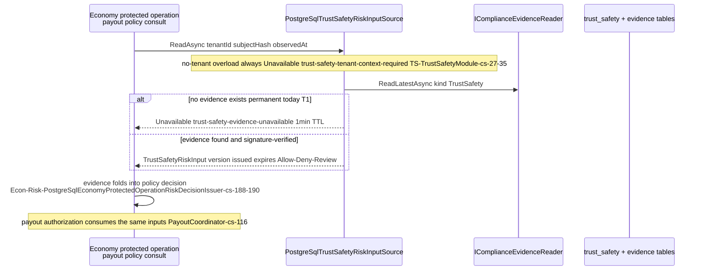
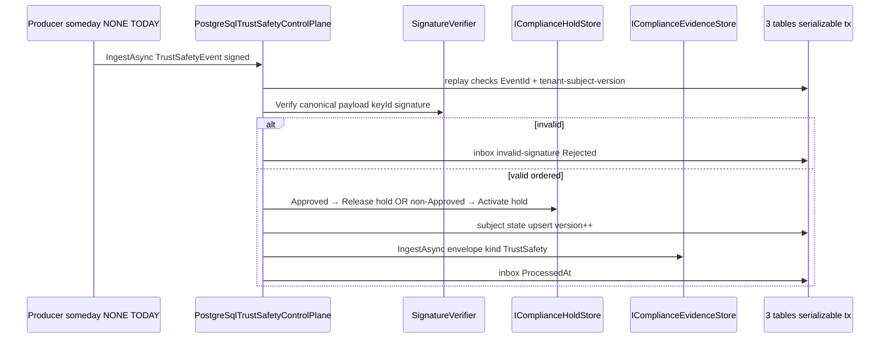
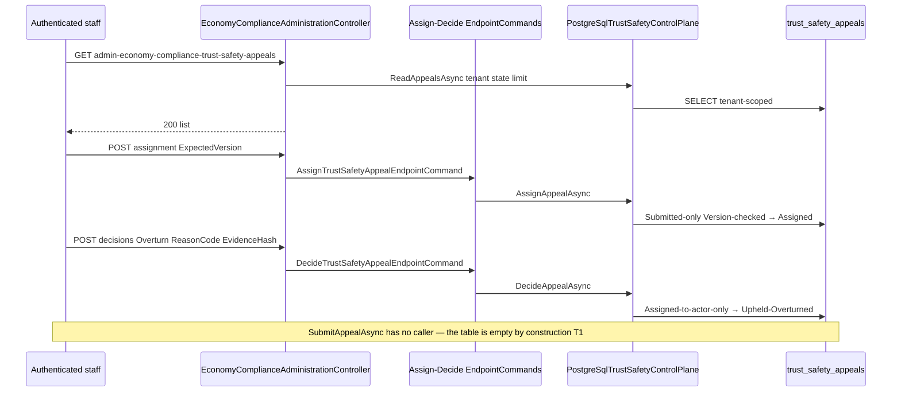
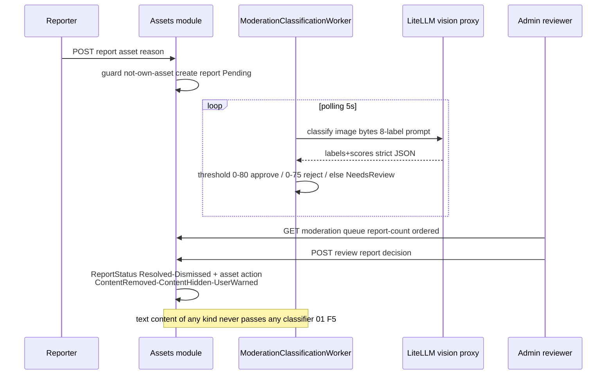

# TrustSafety — Cross-module sequences

> Module `GameGuild.TrustSafety` · develop `ce31d5850c`. Shorthand `TS:`, `Econ:`, `Assets:`, `API:`.

## 1. Economy risk consult (the live consumer path)

## 2. Evidence ingestion — as designed, with the truth flag

The sequence is complete and unit-tested in isolation — only the left-most participant is missing (04 §1).

## 3. Appeal decide — the live console path

## 4. Asset report → moderation action (the content-safety cross-module path that exists)

## 5. Boundary contract — TrustSafety vs. FinancialCrime vs. Assets moderation

| Plane | Scope | Evidence kind | Enforcement |
|---|---|---|---|
| **TrustSafety (this module)** | behavioral risk verdicts on hashed subjects (8 kinds), appeals | `TrustSafety` | economy compliance holds + Allow/Deny/Review on protected ops |
| FinancialCrime (docs/compliance-financialcrime/) | AML cases, examiners, regulatory refs | `financial-crime` | same evidence rail, own case lifecycle |
| Assets moderation | uploaded media content safety | none (rows only) | asset visibility (Rejected hidden, NeedsReview queued) |

The three are frequently conflated in feature requests ("add moderation to TrustSafety") — the intended split: **content** → Assets lane; **behavior/abuse verdicts** → this module's evidence rail; **regulated financial crime** → FinancialCrime. Text moderation belongs to whichever plane the pending #1250 product decision picks; today it exists in none (01 F5).
