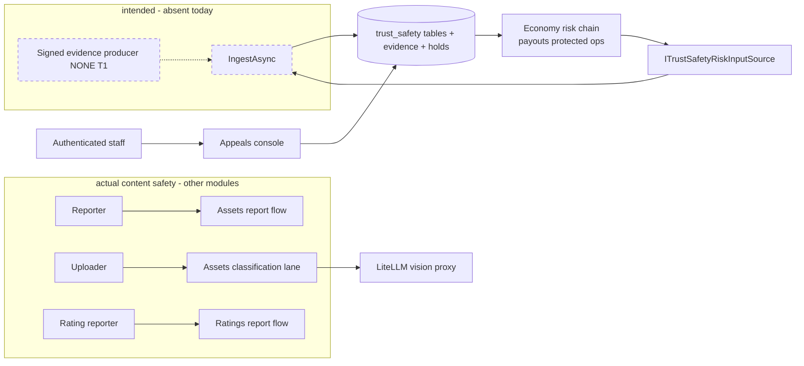
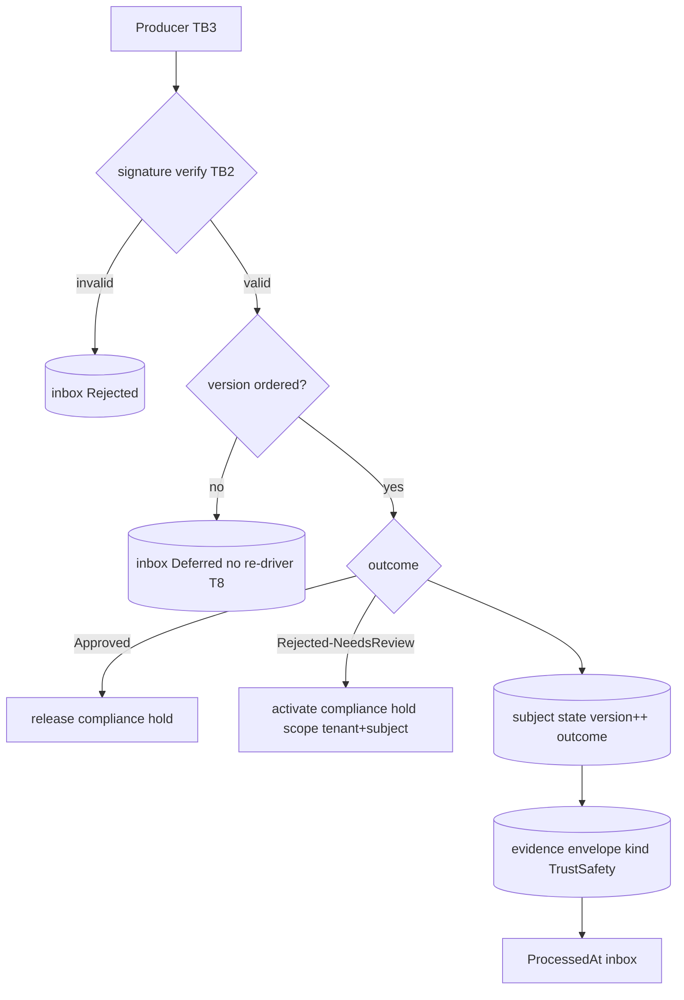
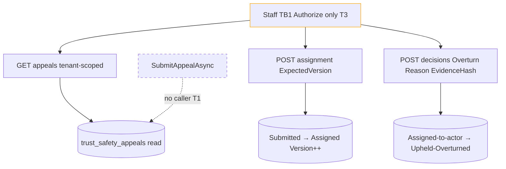
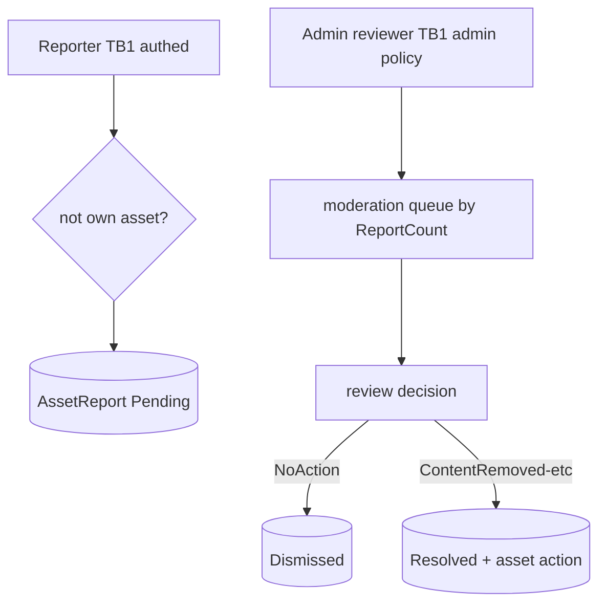
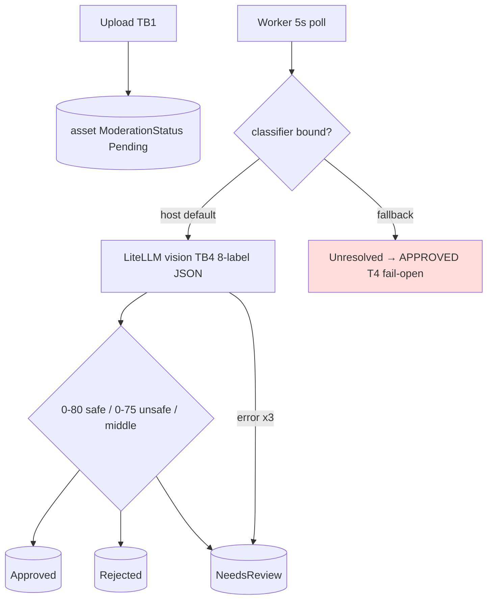
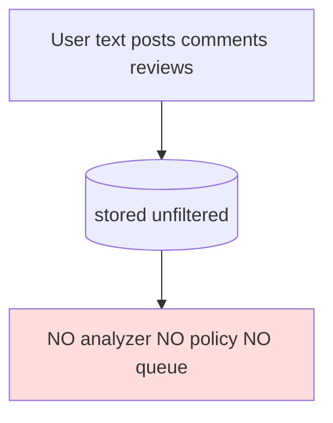

# TrustSafety — Data-flow diagrams

> Module `GameGuild.TrustSafety` + adjacent content-safety surfaces · develop `ce31d5850c`. Families match 01/07.

## L0 — Context

Trust boundaries: TB1 internet→API (staff console `[Authorize]` only — gap T3), TB2 module→DB (EF/raw via Economy persistence), TB3 future producers→ingest (signature boundary), TB4 API→LiteLLM proxy (external LLM, service-network).

## L1-F1 — Evidence ingestion (designed)

## L1-F2 — Appeals console (live)

## L1-F3 — Asset report → review lane

## L1-F4 — Classification lane (the only automated safety)

## L1-F5 — Text surfaces (the documented absence)

## Data stores summary

| Store | Written by | Read by | Live data? |
|---|---|---|---|
| `trust_safety_event_inbox` | IngestAsync (no caller) | replay checks | **empty by construction** |
| `trust_safety_subject_states` | IngestAsync | (via evidence reader) | **empty** |
| `trust_safety_appeals` | SubmitAppealAsync (no caller) | console | **empty** |
| compliance evidence (kind TrustSafety) | IngestAsync | risk input source, economy | **empty** |
| compliance holds | IngestAsync | economy gates | none from this module |
| Assets reports/moderation | report + review + worker | queue, asset visibility | live |
| Ratings report counters | ReportAsync | moderation console | live (bombable) |
