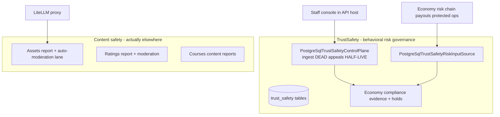

# TrustSafety — Security architecture

> Module `GameGuild.TrustSafety` · develop `ce31d5850c`.

## 1. Component view — the split people get wrong

**Governance vs. moderation.** TrustSafety is a *verdict ledger with economy enforcement* (hashed subjects, signed events, holds, appeals) — it contains **no content inspection**. Content inspection lives in the Assets lane (images only) and the per-module report lifecycles. Text inspection lives nowhere (#1250 N1). Feature requests should be routed accordingly (05 §5).

**Module registration truth.** `TrustSafetyModule : ModuleBase` (`EnabledByDefault => true`, `TS:/TrustSafetyModule.cs:10-16`) is *not* the module system's live path for this module — the composition extension is invoked directly by the economy capability host (`API:/Core/Setup/EconomyCapabilityCompositionExtensions.cs:23`), and the `DisabledModules` listing (`ApiProductComposition.cs:113-116`) has no runtime effect (no handlers exist to skip). Treat the module as **live** in every audit.

## 2. Permission map

| Surface | Gate | Verdict |
|---|---|---|
| GET/POST `admin/economy/compliance/trust-safety/appeals*` (3 routes) | `[Authorize]` only (`EconomyComplianceAdministrationController.cs:38`) | **fail** — needs `Policies.Admin` or a compliance-officer policy (T3) |
| Ingest / submit (no routes) | — | n/a until a producer lands; must carry a service identity + rate budget (07 family 1 DoS) |
| Signature verification | `ICapabilityPolicySignatureVerifier` (economy key ring) | pass — fail-closed rejection with row retained |
| Adjacent: assets review | admin policy on `AssetsAdminController` | pass |
| Adjacent: ratings moderation routes | `TenantAdmin` policy (`Ratings:/Controllers/RatingsController.cs:309-377`) | pass (report route itself open to all authed — see T6) |

## 3. Integrity properties — and non-properties

**Properties held (in code):**

1. Exactly-once ingest per `EventId`; one event per (tenant, subject, version) — unique indexes (`TrustSafetyPersistence.cs:33-35`).
2. Replay-with-different-payload is a hard conflict (`PostgreSqlTrustSafetyControlPlane.cs:92-95`).
3. Signature failure is fail-closed **and** leaves forensic rows (`:118-127`).
4. Subject state advances only on `version == state.Version+1` with monotonic `IssuedAt` (`:132-137`).
5. Holds activate on every non-Approved outcome and release only on Approved events by the system actor (`:139-155`).
6. Appeal transitions are state+assignee+version triple-checked, DB-constraint-backed, one-shot (no reopen) (`:211-250`; `TrustSafetyPersistence.cs:70-80`).
7. Subjects are hash-only in this plane (privacy by construction).

**Non-properties (documented so nobody assumes them):**

1. **No producer exists** — every property above guards traffic that cannot arrive (T1). The economy currently runs with TrustSafety `Unavailable` for every subject.
2. **No hold-release human path in this module** — releases are event-driven only (by design; the FinancialCrime console handles its own).
3. **Deferred rows have no re-driver** (T8).
4. **Nothing rate-limits ingest or the console.**
5. The adjacent moderation fallback **fails open** (`UnresolvedModerationClassifier`, T4) — the single worst security default in this area.

## 4. Fail verdicts (from 07)

| Family | Verdict | Blocking gap |
|---|---|---|
| F1 evidence ingest | pass (inert) | DoS budget missing for future producer |
| F2 appeals console | **fail** | T3 no admin policy |
| F3 report lifecycles | **fail** | T6 report bombing (ratings) |
| F4 moderation lane | partial/**fail** | T4 fail-open fallback; adversarial robustness accepted |
| F5 economy coupling | structural | T1 producer-less rail |

## 5. Deployment invariants

1. Tables ride `20260824180312_AddEconomyProductionPlatform` — the module's EF model must stay in lockstep with that migration's SQL (hand-written, not scaffolded); a model edit without a migration breaks `has-pending-model-changes`.
2. `AddTrustSafetyComposition` must remain inside the economy capability composition (`EconomyCapabilityCompositionExtensions.cs:23`); moving it out silently degrades every economy risk consult to `Unavailable`.
3. The evidence reader registered by the host must override the `UnavailableComplianceEvidenceReader` fallback (`TrustSafetyModule.cs:20` TryAdd) — focused/test hosts that skip the economy composition get the fallback and read nothing.
4. Signature keys are the economy capability-policy key ring — rotating them without coordinating `KeyId` continuity invalidates future ingests (existing rows keep their verdicts).
5. When the first producer lands (T1 decision): ship the admin policy (T3), an ingest rate budget, and a Deferred re-driver (T8) in the same change — the STRIDE families 1-2 assume all three.
6. Do not "enable" text moderation by pointing the Assets image classifier at text — the prompt, thresholds, and human-review MIME list are image-shaped; a text lane needs its own taxonomy and review queue (01 F5).
