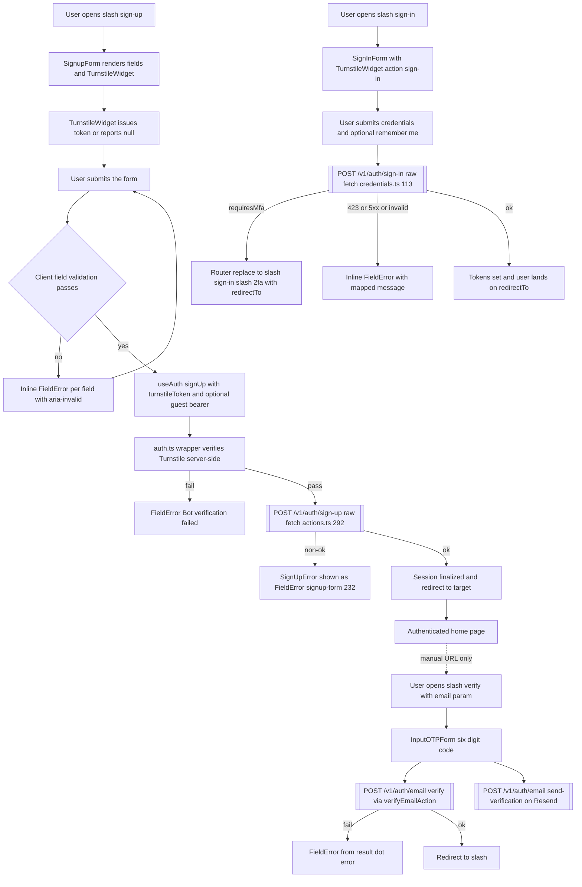

# Journey 1 — Sign-up, email verification, first sign-in

Part of the [UI journeys pack](./README.md). Audited against `develop` (`630eb8c6d7`).
Every code reference is `file:line` in `apps/web` unless a `packages/` path is given.

This is the front-end companion to the auth tables in
[api-contract-matrix.md](../architecture/api-contract-matrix.md) — the matrix says
*which* endpoints are called; this page says *where the user clicks* and *what the
screen does* when they do.

## Entry points

| Entry | Route / component | file:line |
| --- | --- | --- |
| Sign-up page | `/[locale]/sign-up` | `apps/web/src/app/[locale]/(auth)/sign-up/page.tsx:16` |
| Sign-up form | `SignupForm` | `apps/web/src/components/signup-form.tsx:31` |
| Turnstile widget | `TurnstileWidget` (issue #1082) | `apps/web/src/components/antibot/turnstile-widget.tsx:74` |
| Email verification page | `/[locale]/verify` | `apps/web/src/app/[locale]/(auth)/verify/page.tsx:9` |
| Verification form | `VerifyPageContent` → `InputOTPForm` | `apps/web/src/components/auth/verify-page-content.tsx:7`, `apps/web/src/components/input-otp-form.tsx:37` |
| Sign-in page | `/[locale]/sign-in` | `apps/web/src/app/[locale]/(auth)/sign-in/page.tsx:16` |
| Sign-in form | `SignInForm` | `apps/web/src/components/sign-in-form.tsx:29` |
| Legacy `/login` shim | redirect to `/sign-in` | `apps/web/src/app/[locale]/(auth)/login/page.tsx:11` |
| Auth layout guard | bounce authenticated users | `apps/web/src/app/[locale]/(auth)/layout.tsx:24-46` |
| OAuth error banner | `AuthErrorNotice` | `apps/web/src/components/auth/auth-error-notice.tsx:32` |

## Step-by-step click-path

### 1. Open `/sign-up`

The server page renders `GoogleOneTap`, `AuthErrorNotice` (only when `?error=` is
present, `page.tsx:34-35`) and `SignupForm` (`page.tsx:37-47`). Two query params
shape the render:

- `redirectTo` — allowlist-resolved via `resolveAllowedAuthRedirect` (`page.tsx:33`).
- `guestSessionId` (issue #213 guest upgrade) — validated against a GUID pattern
  (`page.tsx:9-10`), passed to the form with a guest-upgrade notice (`page.tsx:37-45`).

### 2. Fill the form and solve Turnstile

`SignupForm` collects name / email / password / confirm-password
(`signup-form.tsx:155-231`). The `TurnstileWidget` mounts inline with
`action="sign-up"` (`signup-form.tsx:234`) and behaves per issue #1082's progressive
engagement posture:

- `NEXT_PUBLIC_TURNSTILE_SITE_KEY` unset → renders nothing, reports `onToken(null)`
  exactly once — the form stays submittable without a challenge
  (`turnstile-widget.tsx:127-133`). The API-side gate fails open while its secret is
  unset, so dev/e2e never blocks.
- Key set → renders the explicit-mode challenge; success, error and expiry all funnel
  through `onToken` (`turnstile-widget.tsx:157-166`). If the Cloudflare script has not
  loaded after 15 s the widget gives up and reports `null`
  (`turnstile-widget.tsx:188-192`) — a silent degrade, not an error banner.
- The API only *requires* the token after repeated failed sign-ins; the UI always
  attaches it when present (`credentials.ts:82` for sign-in; the sign-up body below).

### 3. Submit → `POST /v1/auth/sign-up` (raw fetch, F3)

Client-side validation first (`signup-form.tsx:74-89`): required name/email/password,
min-8 password, confirm match — rendered as inline `FieldError`s with `aria-invalid`
per field.

On submit the form calls `useAuth().signUp` with the derived username, names,
`redirectTo`, `turnstileToken` and — on the guest-upgrade path — the stored guest
bearer (`signup-form.tsx:100-110`). The chain is:

1. `signup-form.tsx:101` → `useAuth().signUp` (client hook).
2. `apps/web/src/auth.ts:100-111` — the app wrapper verifies the Turnstile token
   **server-side first** and throws `CredentialsSignInError("Bot verification failed")`
   before any API call. (Sign-up is gated unconditionally because it is always
   password-based, `auth.ts:95-99`.)
3. `packages/infrastructure/client/src/integrations/next/actions.ts:281` —
   `createSignUpAction` hand-fetches `POST /v1/auth/sign-up` (`actions.ts:292`).
   This is the F3 shadow transport: the generated `postAuthSignUp` method has zero
   callers (matrix, auth table).
4. On success the action **finalizes a session immediately**
   (`finalizeServerAction`, `actions.ts:307`) and redirects to
   `redirectTo ?? '/'` (`actions.ts:309-318`).

So the default post-sign-up landing is an **authenticated** home page — see
[Gaps](#gaps) for what that means for email verification.

### 4. Email verification (manual path) — `/verify?email=…`

Nothing in the UI navigates here (see Gaps). If the user arrives with an `email`
param, `VerifyPageContent` renders the 6-digit `InputOTPForm`
(`verify-page-content.tsx:32`); without the param it bounces to `/sign-in`
(`verify-page-content.tsx:12-15`).

- **Verify** — `verifyEmailAction` → `verifyEmail(apiUrl, { token })`
  (`apps/web/src/lib/auth/password-actions.ts:109-123`), a raw-fetch wrapper from
  `@game-guild/client` (F3 class) hitting `POST /v1/auth/email:verify`. Success
  routes to `/` (`verify-page-content.tsx:22`).
- **Resend Code** — `resendVerificationEmailAction` → `POST /v1/auth/email:send-verification`
  (`password-actions.ts:125-139`), button disabled while resending
  (`input-otp-form.tsx:99-109`).

### 5. First sign-in — `/sign-in`

`SignInForm` (`sign-in-form.tsx:29`) collects email/password + "Remember me"
checkbox (`sign-in-form.tsx:183-199`), with a Turnstile widget
`action="sign-in"` (`sign-in-form.tsx:205`). Providers rendered by the page:
Google button + One Tap, Discord anchor through `/api/auth/signin/discord`
(`(auth)/sign-in/page.tsx:36-39`), wallet buttons, and the capability-gated
guest entry (issue #213, `(auth)/sign-in/page.tsx:47-58`).

Submit (`sign-in-form.tsx:79-85`) → `useAuth().signIn("credentials", …)` →
server action → `CredentialsProvider.authorize` hand-fetches
`POST /v1/auth/sign-in` (`packages/infrastructure/client/src/runtime/auth/providers/credentials.ts:113`,
body incl. `turnstileToken` at `credentials.ts:108`) — F4: the generated
`postAuthSignIn` is never used on `develop`.

Response handling (`credentials.ts:128-166`):

- `requiresMfa` → `MfaRequiredError` carrying `mfaToken`, `availableMethods` and an
  optional `mfaEnrollment` offer (`credentials.ts:144-151`). The form catches it,
  **does not** render it as an error (`sign-in-form.tsx:200-203`), and replaces the
  route to `/sign-in/2fa` with `redirectTo` preserved (`sign-in-form.tsx:93-100`,
  issue #864). The interrupt itself is documented in
  [Journey 2](./02-mfa-enrollment-and-recovery.md).
- `423` → `AccountLockedError` (`credentials.ts:134-136`); `5xx` →
  `AuthServiceUnavailableError` (`credentials.ts:129-132`); other non-ok →
  `CredentialsSignInError` with the API's message. All render as one inline
  `FieldError` under the form (`sign-in-form.tsx:200-203`).
- Success → tokens are session-finalized and the caller lands on `redirectTo`.

## Error states shown by the UI

| State | Component | Where | Shape |
| --- | --- | --- | --- |
| Field validation (name/email/password/confirm) | `SignupForm` | `signup-form.tsx:169-224` | inline `FieldError` + `aria-invalid`, cleared on input |
| Turnstile unverifiable (server) | `SignupForm` via `useAuth` error | `signup-form.tsx:232` | single `FieldError` with `error.message` |
| Sign-up API failure | `useAuth` → `FieldError` | `signup-form.tsx:232` | message from `SignUpError` (`actions.ts:300-305`) |
| Sign-in wrong credentials / locked / API down | `SignInForm` | `sign-in-form.tsx:200-203` | inline `FieldError`; `MfaRequired` filtered out |
| OAuth callback failure | `AuthErrorNotice` | `auth-error-notice.tsx:32-43` | destructive `Alert` banner; code map `:10-17` normalizes to 5 keys, unknown codes → `generic` |
| OTP too short | `InputOTPForm` | `input-otp-form.tsx:48-50` | `FieldError` "enter the full 6-digit code" |
| Verify/resend failure | `InputOTPForm` | `input-otp-form.tsx:54-62`, `:71-79` | `FieldError` with the action's error string |
| Loading | both forms | `signup-form.tsx:235-237`, `sign-in-form.tsx:206-212` | submit disabled + "Creating account…/Signing in…" |
| Empty state | `/verify` without email | `verify-page-content.tsx:12-15` | redirect, no UI |

The house fallback convention (established by the #1217 fix on
`fix/client-broken-calls`, pending merge at audit time): a failed data load renders
an `Alert variant="destructive"` **in place of** the component, never a silently
empty screen. The `(auth)` pages predate it and use inline `FieldError`s instead —
consistent within the journey, but not the destructive-alert shape.

## Accessibility notes

- Every input has a `FieldLabel htmlFor` binding; errors use `FieldError`
  (aria-live region in the design system) and `aria-invalid` flips on the field
  (`signup-form.tsx:166-168`, `sign-in-form.tsx:147-152`).
- Turnstile container: `role="group"` + `aria-label="Bot verification challenge"`
  with an `sr-only` instruction (`turnstile-widget.tsx:203-206`).
- Keyboard path: standard tab order — providers → fields → widget → submit. The
  "Forgot your password?" link is deliberately `tabIndex={-1}` inside the password
  field row (`sign-in-form.tsx:178`) so the password field's tab goes to Remember-me,
  not the link; screen-reader/keyboard users reach it via shift-tab or the footer
  links. The OTP inputs auto-advance (InputOTP design system).
- The sign-in submit button stays disabled until hydration
  (`data-auth-ready`, `sign-in-form.tsx:49-53`, `:209`) to prevent a pre-hydration
  no-op submit.
- `Remember me` checkbox has an explicit `aria-label` ("Remember me on this device",
  `sign-in-form.tsx:192`).
- `AuthErrorNotice` icon is `aria-hidden`; text rides the alert role.

## Edge cases

- **Offline / API unreachable** — `fetch` throws → `AuthServiceUnavailableError`
  ("Authentication service is unreachable…") rendered inline
  (`credentials.ts:114-121`); the Turnstile script failing to load degrades to a
  token-less submit which the API may then reject.
- **Session expiry mid-flow** — sign-up finalizes a session immediately, so there is
  no pending state to expire; sign-in failure simply re-renders the form. The `(auth)`
  layout bounces already-authenticated users off auth pages with the allowlisted
  `callbackUrl` (`(auth)/layout.tsx:24-46`), including the self-target loop guard
  (`:38-41`).
- **MFA interrupt** — `MfaRequired` navigates to `/sign-in/2fa` instead of erroring;
  the 2FA completion exception keeps the route reachable while backup codes are on
  screen (`(auth)/layout.tsx:27-28`, `:42-44`).
- **Guest upgrade** — a stale/mismatched guest session never blocks registration: the
  bearer is attached only when the stored guest id matches the param
  (`signup-form.tsx:94-98`) and the guest slot is cleared either way after the
  attempt (`signup-form.tsx:112-115`).
- **Single-use Turnstile token** — reset to `null` after any failed submit so the
  widget re-issues (`signup-form.tsx:117-119`, `sign-in-form.tsx:86-88`).
- **Old bookmarks** — `/login` redirects to `/sign-in` (`(auth)/login/page.tsx:11`).

## Gaps

**Known** (already tracked in the matrix / issues):

- **F3/F4 raw transports** — sign-up, sign-in and email verification all bypass the
  generated client (`actions.ts:292`, `credentials.ts:113`,
  `password-actions.ts:115/131`); the Turnstile field itself shipped through this
  untyped path (#1082, matrix F4). The #1217 PR on `fix/client-broken-calls`
  migrates sign-in to `postAuthSignIn`/`postAuthMfaSignInComplete` — not on
  `develop` at audit time.
- **F1** — the shipped Next auth handler's `mfa&providerId=enrollment` action posts
  to the unserved `/v1/auth/mfa/sign-in/enrollment`
  (`packages/infrastructure/client/src/integrations/next/handlers.ts:364`). Not on
  this journey's default click-path (the RSC form uses the server action), but any
  consumer hitting that handler action gets a 404 (#1217, pending fix).

**NEW (found while writing this journey):**

- **The email-verification step is unreachable by navigation.** Sign-up redirects
  straight to an authenticated `redirectTo ?? '/'` (`actions.ts:309-318`) and no
  component links to `/verify` — the only references to the route are its own page
  file and its test fixtures. A new user never sees the OTP screen unless they type
  `/verify?email=…` by hand. Either the sign-up success path should route through
  `/verify`, or the page should be declared an email-tool deep-link target.
- **Nothing enforces verified email at sign-in.** The credentials provider accepts
  any valid email/password and mints tokens without checking a verified flag
  (`credentials.ts:140-166`), and the sign-up response path does not surface
  `emailVerified`. Combined with the previous gap, the "email verification" leg of
  this journey is effectively optional in the current UI.
- **Turnstile load timeout is silent.** After 15 s the widget reports `null` and the
  form remains submittable with no token (`turnstile-widget.tsx:188-192`); when the
  API-side gate is strict the user then gets only the generic
  "Bot verification failed" — no affordance to retry the challenge itself.
- **`AuthErrorNotice` covers only OAuth callback codes** (`auth-error-notice.tsx:10-17`).
  Credentials-flow error strings are shown raw from the API message; there is no
  code→translation mapping for them (e.g. lockout vs. bad password), so localization
  depends entirely on the API's message language.

## Flow diagram

