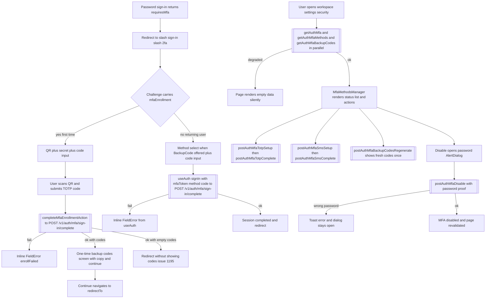

# Journey 2 — MFA enrollment and recovery

Part of the [UI journeys pack](./README.md). Audited against `develop` (`630eb8c6d7`).

Covers two MFA surfaces: the **sign-in-bound enrollment** (a policy-forced first-time
setup that interrupts sign-in, issues #1231/#1195) and the **settings-managed**
methods (TOTP, SMS, backup codes, disable — issue #244), plus the account-recovery
password flows that a locked-out MFA user falls back on. Email-MFA (shipped by
#1168) is included as a gap: it has API surface and no UI.

## Entry points

| Entry | Route / component | file:line |
| --- | --- | --- |
| Sign-in MFA interrupt | `/[locale]/sign-in/2fa` | `apps/web/src/app/[locale]/(auth)/sign-in/2fa/page.tsx:13` |
| MFA challenge / enrollment form | `MfaChallengeForm` | `apps/web/src/components/auth/mfa-challenge-form.tsx:39` |
| Enrollment completion action | `completeMfaEnrollmentAction` | `apps/web/src/lib/auth/mfa-sign-in-actions.ts:19` |
| Security settings page | `/[locale]/workspace/settings/security` | `apps/web/src/app/[locale]/(dashboards)/workspace/settings/security/page.tsx:11` |
| MFA methods manager | `MfaMethodsManager` | `apps/web/src/components/settings/mfa-methods-manager.tsx:50` |
| MFA server actions | `lib/auth/mfa-actions.ts` | `apps/web/src/lib/auth/mfa-actions.ts:105` (loader), `:118`-`:194` (mutations) |
| Duplicate action set | `lib/user-settings/mfa-actions.ts` | `apps/web/src/lib/user-settings/mfa-actions.ts:28` |
| 2FA nudge banner | `TwoFactorNudgeBanner` (issue #838) | `apps/web/src/components/settings/two-factor-nudge-banner.tsx:66`, rendered at `apps/web/src/app/[locale]/(dashboards)/layout.tsx:103` |
| Forgot password | `/[locale]/forgot-password` | `apps/web/src/components/forgot-password-form.tsx:15` |
| Reset password | `/[locale]/reset-password` | `apps/web/src/components/reset-password-form.tsx:19` |

## Step-by-step click-path

### A. Sign-in-bound enrollment (forced by policy, issue #1231)

1. Password sign-in answers `requiresMfa` with an `mfaEnrollment` offer
   (`packages/infrastructure/client/src/runtime/auth/providers/credentials.ts:144-151`).
   `SignInForm` navigates to `/sign-in/2fa` (see
   [Journey 1](./01-sign-up-email-verification-first-sign-in.md)); the challenge —
   `mfaToken`, `availableMethods`, `mfaEnrollment` — lives in the app-wide auth
   context and survives the navigation.
2. `MfaChallengeForm` detects `mfaEnrollment` and renders the first-time setup:
   QR code (`data-testid="mfa-enrollment-qr"`, `mfa-challenge-form.tsx:230-238`),
   the setup key with copy button (`:241-274`), and a numeric 6-char code input
   (`:293-305`).
3. **Submit** → `completeMfaEnrollmentAction(mfaToken, code)`
   (`mfa-challenge-form.tsx:90-93`) → `createMfaEnrollmentCompleteAction`
   (`packages/infrastructure/client/src/integrations/next/actions.ts:231`), which
   replays the credentials provider with `mfaToken/method/code`
   (`actions.ts:240-243` → `credentials.ts:96-104` → hand-fetched
   `POST /v1/auth/mfa/sign-in/complete`, `credentials.ts:102/113`).
4. The server returns the session tokens **plus** `mfaEnrollmentBackupCodes`
   (`credentials.ts:166-169`), which ride only the server-action result — never
   URLs, cookies or JWT claims (`mfa-sign-in-actions.ts:7-13`).
5. The form swaps to the **one-time backup-codes screen**
   (`mfa-challenge-form.tsx:100-104` → `:127-181`,
   `data-testid="mfa-enrollment-backup-codes"` at `:140`): the code grid, a
   Copy button that never claims success when the clipboard denies permission
   (`:61-72`), and a Continue button that performs the exit redirect
   (`:149-158`). This is the #1195 fix — the codes the backend generated are now
   displayed exactly once, with the auth layout's 2FA exception keeping the route
   reachable until the user acknowledges them
   (`(auth)/layout.tsx:27-28`).
6. **Start again** clears the challenge and the codes
   (`mfa-challenge-form.tsx:74-77`) — the #1231 lockout-breaker.

### B. Returning-user MFA challenge

On `/sign-in/2fa` without an enrollment offer: a method `<select>` appears only when
`BackupCode` is among `availableMethods` (`:276-292`), plus the code input. Submit
calls `useAuth().signIn("credentials", { mfaToken, method, code })`
(`:114-121`) → same `POST /v1/auth/mfa/sign-in/complete` raw fetch
(`credentials.ts:96-104`). Without any challenge in context (deep link, expired
challenge) the form renders the no-challenge notice with a back-to-sign-in link
(`:183-204`).

### C. Settings-managed methods (issue #244)

`/workspace/settings/security` server-loads three payloads in parallel —
`getAuthMfa` (configuration), `getAuthMfaMethods` (catalog),
`getAuthMfaBackupCodes` (status) — each through the generated
`AuthMultiFactorModule` with the session bearer (`mfa-actions.ts:105-115`),
wrapped in `safeLoad` so contract drift degrades to empty data instead of
crashing the RSC render (`mfa-actions.ts:93-102`, issue #864).

`MfaMethodsManager` then offers:

| Click | Component handler | API call (generated module) |
| --- | --- | --- |
| Set up authenticator | `handleStartTotp` (`mfa-methods-manager.tsx:74-88`) | `postAuthMfaTotpSetup` (`mfa-actions.ts:118-127`) — returns secret + QR URI |
| Confirm TOTP code | `handleCompleteTotp` (`:90-107`) | `postAuthMfaTotpComplete` (`mfa-actions.ts:130-142`) + `revalidatePath` |
| Set up SMS | `handleStartSms` (`:109-123`) | `postAuthMfaSmsSetup` (`mfa-actions.ts:145-154`) |
| Confirm SMS code | `handleCompleteSms` (`:125-140`) | `postAuthMfaSmsComplete` (`mfa-actions.ts:157-168`) |
| Regenerate backup codes | `handleRegenerate` (`:142-155`) | `postAuthMfaBackupCodesRegenerate` (`mfa-actions.ts:171-181`) — fresh list shown once (`:328-339`) |
| Disable MFA | `handleDisable` (`:157-172`) | `postAuthMfaDisable` with password proof (`mfa-actions.ts:184-194`) |

The **disable dialog is the #1164/#1231 password re-verification pattern**: an
`AlertDialog` collects the account password (`mfa-methods-manager.tsx:348-392`),
the server enforces password proof, and a wrong password keeps the dialog open
(the action button `preventDefault`s Radix's close, `:374-388`, issue #864) and
toasts the failure (`:167`). The same re-verify shape guards the password change
card in [Journey 4](./04-account-settings-sessions-sign-out.md).

### D. Recovery (when the second factor is lost)

The UI's only account-recovery path is the password reset pair, both Turnstile-gated
server-side before any API call (`password-actions.ts:18-60`, `:62-107`):

1. `/forgot-password` → `requestPasswordResetAction` → raw-fetch
   `POST /v1/auth/password:reset-request` (`password-actions.ts:29`) — always
   "success" from the caller's view unless the backend rejects, to prevent email
   enumeration (`password-actions.ts:38-53`).
2. `/reset-password` → `completePasswordResetAction` → raw-fetch
   `POST /v1/auth/password:reset` (`password-actions.ts:78`).

An MFA-locked-out user has **no** "sign in with a backup code from here" link on
`/sign-in/2fa` (they must know the method select appears after a password attempt),
and no account-recovery request UI (see Gaps).

## Error states shown by the UI

| State | Component | Where | Shape |
| --- | --- | --- | --- |
| Enrollment completion failed | `MfaChallengeForm` | `mfa-challenge-form.tsx:306-308` | inline `FieldError`; stale-action 409 auto-reloads (`:105-107`, issue #1035) |
| Challenge verification failed | `MfaChallengeForm` | `:309-313` | inline `FieldError` (non-enrollment branch) |
| No challenge in context | `MfaChallengeForm` | `:183-204` | notice card + back link |
| Action failed (settings) | `MfaMethodsManager` | `:70-72` | `toast.error` (sonner) with the action's message or a generic |
| Wrong password on disable | `MfaMethodsManager` | `:167`, dialog stays open `:374-388` | toast + retained dialog |
| Loader degraded (contract drift) | security page via `safeLoad` | `mfa-actions.ts:93-102` | renders with empty data — **silent** fallback, no banner (safeLoad predates the #1217 destructive-alert convention) |
| Backup codes empty from backend | settings regenerate | `mfa-actions.ts:180` (`codes ?? []`) | success toast with an empty grid — the #1195 symptom in settings shape |
| Password reset failures | forgot/reset forms | `forgot-password-form.tsx:111`, `reset-password-form.tsx:36-38` | inline `FieldError` |
| Loading | all | e.g. `mfa-methods-manager.tsx:223-235` | buttons disabled while `busy` |
| Empty | no methods / no codes | `:325`, `:299-300` (sessions) | muted "none" copy |

## Accessibility notes

- QR image has a translated `title` (`mfa-challenge-form.tsx:235`) and the secret is
  available as copyable text — an authenticator can be set up without sight.
- Copy buttons expose `aria-label` (`:259`) and swap icon+label on success; clipboard
  denial keeps the idle label (never lies, `:67-72`).
- Method list, status badge and recovery status carry `data-testid`s but the visual
  labels are plain text (`Badge` + icon `aria-hidden`), so screen readers get
  "Enabled/Disabled" not just color.
- The disable `AlertDialog` is focus-trapping Radix; the submit button is disabled
  until a password is entered (`:384`).
- OTP/code inputs use `autoComplete="one-time-code"` + `inputMode="numeric"`
  (`:298-300`); the settings TOTP/SMS inputs match (`mfa-methods-manager.tsx:254-256`,
  `:297-299`).
- Keyboard path: the settings card is plain DOM (buttons + inputs), fully keyboard
  reachable; the sign-in form's method select is a native `<select>` (`:281-290`).

## Edge cases

- **Offline** — enrollment completion and challenge submits surface the mapped
  provider error inline; settings mutations toast the failure and leave the card in
  its pre-action state (no optimistic updates).
- **Session expiry mid-enrollment** — the enrollment completes in one round trip, so
  the dangerous window is empty; but if the *action bundle* is stale (409), the form
  reloads once automatically (`recoverFromStaleServerAction`,
  `mfa-challenge-form.tsx:106`, issue #1035).
- **Challenge expiry** — a direct visit or refresh after expiry renders the
  no-challenge notice; the user restarts from `/sign-in`.
- **Backup-code entry for returning users** — only offered when the backend listed
  `BackupCode` in `availableMethods` (`:276`); TOTP-only users never see the select.
- **Refresh after disable** — every mutation `revalidatePath`s the security page
  (`mfa-actions.ts:135/161/174/186`), so the list, badges and recovery counts
  re-derive from the server.
- **Nudge banner lifecycle** — dismissal is per-browser in localStorage
  (`gg.2fa-nudge`) for 30 days; enabling 2FA clears it so a later disable re-arms
  the nudge (`two-factor-nudge-banner.tsx:15-19`, `:70-76`).

## Gaps

**Known:**

- **#1195 (open)** — empty backup codes from the enrollment endpoint. The UI now
  *has* the one-time display path (the fix landed in the #1231 work), but if the
  backend still returns an empty array the form skips the screen entirely and
  redirects (`mfa-challenge-form.tsx:100-104`) — the user never learns codes were
  expected. The settings `regenerate` shows an empty grid + success toast
  (`mfa-actions.ts:180`). Track the residual server-side cause under #1195.
- **Matrix A2 dead clusters** — `mfa/email:*` (setup/challenge/complete), the whole
  `mfa/recovery:*` trio, push MFA and `admin/users/{id}/mfa:reset` have zero web
  callers.
- **F1 (#1217, pending PR)** — the handler-based MFA-enrollment action posts to the
  unserved `/v1/auth/mfa/sign-in/enrollment` (`handlers.ts:364`); the RSC flow here
  does not use it, but it is the same feature's shipped surface.

**NEW:**

- **Email MFA has no UI.** #1168 shipped `postAuthMfaEmailSetup`, `:challenge`,
  `:complete` into the client, and the settings catalog renders whatever
  `getAuthMfaMethods` returns — but `MfaMethodsManager` only implements TOTP and SMS
  branches (`mfa-methods-manager.tsx:74-140`). An email-method row would render as
  enrollable-looking data with **no button** to enroll it.
- **No MFA-account-recovery UI.** `/v1/auth/account-recovery/request|approve|reset`
  (6 endpoints, 0 callers, matrix A2) have no page; a user who lost both factors has
  only the password reset, which does not clear MFA.
- **Duplicate MFA action sets.** `lib/auth/mfa-actions.ts` and
  `lib/user-settings/mfa-actions.ts` both wrap `AuthMultiFactorModule` with
  different result shapes; only the former is used by the security page
  (`security/page.tsx:5`). The `user-settings` copy is dead weight inviting drift.
- **Silent degrade on the security page loader.** `safeLoad` collapses a failed
  `getAuthMfa` into "MFA: disabled-looking empty page" with no destructive-alert
  fallback — the exact class the #1217 convention was established for. A user with a
  broken contract sees a security page that *looks like* MFA is off.
- **SMS enrollment panel lets the user type a phone, then start, then type a code
  in the same panel** — but the panel renders the phone input again after starting
  (`mfa-methods-manager.tsx:270-306`); canceling mid-way silently discards the
  pending number with no warning.

## Flow diagram

